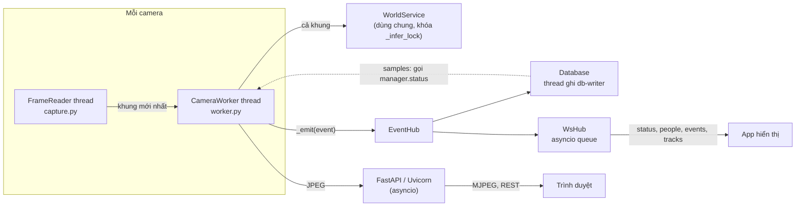

# Tài liệu code

Dành cho người bảo trì / phát triển tiếp. Cài đặt môi trường: [SETUP.md](SETUP.md). Dữ liệu gửi ra ngoài: [WEBSOCKET_API.md](WEBSOCKET_API.md).

## 1. Tổng quan

Một tiến trình Python duy nhất:

- **Backend**: FastAPI + Uvicorn (`app/`). Đọc nhiều camera song song, phát hiện + theo dõi người (Ultralytics YOLO pose + ByteTrack), phát hiện đồ vật theo từ khóa (YOLOE-26l, một model dùng chung; code vẫn hỗ trợ YOLO-World), đếm vào/ra theo line hoặc polygon, lưu SQLite, đẩy WebSocket.
- **Frontend**: HTML + JavaScript thuần (`web/`), không build step. Video xem qua MJPEG, số liệu qua polling `/api/status` mỗi giây.
- **Cấu hình**: `config/settings.json` (thông số, camera) và `config/vocabulary.json` (từ khóa đồ vật), sửa qua web.

Thư viện chính: `ultralytics`, `torch`, `opencv-python`, `fastapi`, `uvicorn`, `websockets`, `lap`, CLIP (`git+https://github.com/ultralytics/CLIP.git`, bộ tách từ cho bộ mã hóa chữ MobileCLIP `models/mobileclip2_b.ts`; chỉ cần khi thêm từ mới).

## 2. Cấu trúc thư mục

```
Exhibition/
├── app/                    Backend (package Python, chạy bằng `python -m app`)
│   ├── __main__.py         Entry point: parse tham số, chdir vào models/, chạy uvicorn
│   ├── main.py             FastAPI: trang, REST API, MJPEG, /ws, API database
│   ├── manager.py          CameraManager: giữ các worker, WorldService, EventHub, Database
│   ├── worker.py           CameraWorker: 1 thread / camera, pipeline xử lý từng khung
│   ├── capture.py          FrameReader: thread đọc RTSP/webcam/file, chỉ giữ khung mới nhất
│   ├── person.py           Person (dataclass), PersonTracker (YOLO pose + ByteTrack)
│   ├── crossing.py         CrossingCounter: line / zone, phía trong-ngoài, lượt vào/ra
│   ├── world.py            WorldService: model đồ vật dùng chung, mã hóa từ vựng, ngưỡng, lọc trùng
│   ├── objtrack.py         ObjectTracker: ByteTrack cho đồ vật (1 / camera, dãy mã riêng)
│   ├── items.py            ItemTracker: track vật, gán cho người theo bbox, bỏ phiếu nhãn
│   ├── vocabulary.py       Bộ từ mặc định, nhóm alert / suppress, đọc-ghi vocabulary.json
│   ├── draw.py             Vẽ overlay (người, khung xương, đồ vật, line, zone, HUD)
│   ├── events.py           EventHub: pub/sub trong tiến trình
│   ├── db.py               Database: SQLite (WAL), thread ghi riêng, truy vấn thống kê, CSV
│   ├── ws.py               WsHub: server WebSocket, topic, tần suất, token
│   ├── settings_store.py   SettingsStore: giá trị mặc định, merge, lưu settings.json (thread-safe)
│   └── paths.py            Đường dẫn chuẩn, resolve_model()
├── web/                    Frontend tĩnh (mount tại /static)
│   ├── index.html, cameras.html, calibrate.html, world.html, data.html, socket.html
│   ├── js/common.js        api(), toast(), esc(), renderNav(), định dạng thời gian
│   ├── js/<trang>.js       Logic từng trang
│   └── css/style.css
├── config/                 settings.json (không có trong git), vocabulary.json
├── models/                 *.pt, mobileclip2_b.ts, yoloe_exhibition.json (không có trong git, tạo bởi tools/prepare_models.py)
├── data/                   exhibition.sqlite3 (không có trong git)
├── tools/
│   ├── prepare_models.py   Tải model, mã hóa từ vựng đồ vật (setup.bat và Dockerfile gọi)
│   ├── build_portable.ps1  Tạo dist\VisionExpo (Python nhúng + thư viện + app)
│   └── docker_export.ps1   Build image + xuất tar và bộ script cài cho máy khác
├── docker/                 entrypoint.sh, deploy/ (compose + .bat cho máy đích)
├── Dockerfile, docker-compose.yml, .dockerignore
├── setup.bat, start.bat, start_kiosk.bat, build_portable.bat, docker_export.bat
├── requirements.txt
└── docs/
```

## 3. Mô hình luồng (thread)



| Thread / task | Ở đâu | Làm gì |
|---|---|---|
| Uvicorn event loop | `__main__.py` | HTTP, MJPEG (async generator), WebSocket |
| `FrameReader` (1 / camera) | `capture.py` | Đọc liên tục, giữ 1 khung mới nhất + số thứ tự, tự kết nối lại |
| `worker-<id>` (1 / camera) | `worker.py` | Pipeline xử lý, giới hạn bởi `process_fps` |
| `world-load`, `world-rebuild` | `world.py` | Nạp model / mã hóa lại từ vựng ở nền |
| `db-writer` | `db.py` | Gom sự kiện thành batch để ghi, lấy mẫu số liệu định kỳ, xóa dữ liệu cũ |
| Tasks asyncio của `WsHub` | `ws.py` | `_pump_events` (sự kiện → client), `_ticker` cho `status` và `people` |

Nguyên tắc:

- Worker chỉ **đọc khung mới nhất**, không xếp hàng, nên không bị trễ dồn khi xử lý chậm.
- `WorldService.predict` có khóa: nhiều camera dùng chung GPU theo lượt. Mỗi camera chỉ gọi mỗi `every_n` khung, một lần trên cả khung hình (chi phí không phụ thuộc số người).
- Subscriber của `EventHub` được gọi trên thread worker, phải **không chặn** (DB đẩy vào `queue.Queue`, WsHub dùng `loop.call_soon_threadsafe`).
- Dữ liệu chia sẻ giữa các thread (`worker.persons`, `worker.objects`) được gán nguyên list mới mỗi khung, nên phía đọc luôn thấy một bản đầy đủ.

## 4. Pipeline một khung (`CameraWorker._process`)

1. **Người**: `PersonTracker.track(frame)` → `list[Person]` (box, track_id, keypoints).
2. **Phía / đếm**: `CrossingCounter.update(persons, w, h)` gán `p.side` (`in`/`out`/`unknown`), tính `inside`/`outside`, sinh sự kiện `crossing`.
3. **Đồ vật** (nếu bật, mỗi `every_n` khung):
   - `scope = "person"` (mặc định): `WorldService.detect(frame, keep_rivals=True)` trên cả khung (model tự letterbox về `imgsz`), lọc trùng nhưng giữ các cách đọc khác nhóm → `ItemTracker.update(dets, persons, cfg)`: track vật bằng ByteTrack, rồi gán cho người theo bbox. Mỗi khung: `ItemTracker.render(persons, show_conf)` trả vật đã ổn định, đồng thời gán `p.items` và `p.alert`.
   - `scope = "frame"`: `WorldService.detect(frame)` trên cả khung, không track, lọc theo `show_conf`, `attach_objects()` gán vật cho người.
4. **Theo dõi lượt người**: `_update_tracks()` cộng dồn đồ vật / phía cho từng `track_id`, phát `alert` (tối đa 30 giây/lần/người), và phát `track` khi người biến mất quá 3 giây.
5. **Vẽ + phát**: `draw.render()` → resize theo `stream_width` → JPEG → `latest_jpeg()` cho MJPEG.

## 5. Các module chính

### `settings_store.py`

- `GLOBAL_DEFAULTS`, `CAMERA_DEFAULTS`: **nguồn duy nhất** của giá trị mặc định. Khi load, file được deep-merge lên mặc định, nên khóa mới tự có giá trị cho file cũ.
- `update_global(patch)`, `update_camera(id, patch)`: merge, ghi file (atomic qua `.tmp`), trả bản mới.
- `RESTART_FIELDS = {"source", "enabled"}`: đổi các khóa này thì manager tạo worker mới; các khóa khác áp dụng nóng qua `worker.apply_config()`.
- Server giữ cấu hình trong bộ nhớ và **ghi đè file mỗi lần lưu**: sửa tay `settings.json` khi server đang chạy sẽ bị mất.

### `manager.py` – `CameraManager`

Tạo `WorldService`, `EventHub`, `Database` (subscribe `db.on_event`), các `CameraWorker`. CRUD camera, `update_world()` (lưu + `world.update_config`), `update_section()` cho websocket/database, `status()` gom số liệu mọi camera (dùng cho `/api/status`, WebSocket `status`, và DB lấy mẫu). Thiết bị: `device` trong settings hoặc `--device`; không có CUDA thì tự về `cpu`.

### `capture.py` – `FrameReader`

Phân loại nguồn (`webcam` / `stream` / `file`), mở bằng OpenCV (RTSP qua TCP, timeout 8 giây), thread đọc liên tục, `latest()` trả `(frame, seq)`. Trạng thái: `starting`, `connecting`, `online`, `offline`, `reconnecting`, `stopped`. File video tự phát lặp. `grab_single_frame()` dùng cho nút "Kiểm tra".

### `crossing.py` – `CrossingCounter`

- Xét theo **điểm chân** (`Person.foot_point()`: trung điểm hai mắt cá nếu đủ tin cậy, ngược lại đáy giữa box).
- **Vùng đệm** `DEAD_ZONE_FRAC` (0.6% đường chéo khung): điểm nằm trong dải này không đổi phía, tránh nhảy qua lại trên biên.
- **line**: dấu của tích chéo với đoạn A–B; phía "trong" là phía chứa `inward_point`. Đổi phía và điểm cắt nằm trong đoạn (cho phép lố 10%) → một lượt.
- **zone**: `cv2.pointPolygonTest` có dấu khoảng cách. Ngoài → trong = `in`, trong → ngoài = `out` kèm `dwell_s`. Track xuất hiện sẵn bên trong: tính là đang ở trong, không phát sinh lượt vào.
- `COOLDOWN_S = 1`: một track không được đếm hai lần trong 1 giây.
- `inside` / `outside`: đếm `p.side` của khung hiện tại. `entries` / `exits`: cộng dồn, khôi phục từ DB khi khởi động (`restore_counts`).
- Đổi cấu hình hình học (mode/points/zone) thì xóa trạng thái các track.

### `world.py` – `WorldService`

- Model gốc `WORLD_BASE_MODEL` (`app/paths.py`, mặc định `yoloe-26l-seg.pt`; `yolov8s-worldv2.pt` cũng chạy được). `bake_vocabulary()` mã hóa từng prompt bằng bộ mã hóa chữ của model (MobileCLIP với YOLOE, CLIP với YOLO-World), lấy trung bình các prompt của một nhãn, ghi vào `models/yoloe_exhibition.pt` cùng file chữ ký `yoloe_exhibition.json` (model gốc + danh sách nhãn và prompt). Khi chạy chỉ load model đã mã hóa, không cần bộ mã hóa chữ.
- Khi khởi động, chữ ký khác `vocabulary.json` (thêm từ, đổi prompt, đổi model gốc) → tự mã hóa lại.
- Mỗi nhãn một danh từ thông dụng: thêm từ đồng nghĩa (thành nhãn riêng hay thành prompt trung bình) đo được là giảm độ nhạy ("glasses" một mình 16/24 khung, trung bình với eyeglasses/sunglasses 0/24).
- Bật/tắt từ chỉ là `classes=` khi predict, không cần mã hóa lại.
- **Ngưỡng theo nhãn** `_conf(label)`: `category_conf[nhóm]` nếu có → nhãn ẩn (quần áo, tóc) dùng `HIDDEN_CONF = 0.15` → vũ khí dùng `alert_conf` → còn lại `conf`. Predict chạy ở ngưỡng nhỏ nhất rồi lọc từng nhãn. Bỏ box có cạnh ngắn < `min_obj_px` (trừ nhãn ẩn).
- `_dedup(found, keep_rivals)`:
  - `keep_rivals=False` (scope frame): mỗi vùng giữ một box tự tin nhất; box quần áo/tóc nuốt box phụ kiện yếu hơn khi trùng ≥ `SUPPRESS_IOU`; sau đó bỏ nhãn ẩn.
  - `keep_rivals=True` (scope person): chỉ gộp box **cùng nhóm** (từ đồng nghĩa); các cách đọc khác nhóm và nhãn ẩn được giữ lại cho `ItemTracker` phân xử.
- `WorldObject`: `label, conf, box, alert, owner, rel (box tương đối khung người), category, hidden`.

### `objtrack.py` – `ObjectTracker`

ByteTrack của ultralytics (`BYTETracker`) dùng cho đồ vật, mỗi camera một instance (nằm trong `ItemTracker`). `STrack` của ultralytics lấy mã từ một bộ đếm toàn cục dùng chung với tracker người, và mỗi `BYTETracker()` mới reset bộ đếm đó; lớp con `_ObjTrack` / `_ObjByteTracker` có bộ đếm riêng và bỏ reset để không làm nhảy mã người. Mọi box đầu vào đã qua ngưỡng theo nhãn nên đều được coi là box "high"; `fuse_score` tắt (box tin cậy thấp như tóc vẫn ghép được). `update(boxes, confs)` trả mã track cho từng box (kể cả track mới chưa xác nhận), giữ track mất dấu `TRACK_BUFFER = 15` lần chạy.

### `items.py` – `ItemTracker` (scope person)

Mỗi vật được track là một **slot** (một vùng vật lý), gắn với người đang mang nó.

1. **Gom nhóm trong một lần quét** (`_group`): các box chồng nhau (IoU ≥ 0.4, diện tích tương đương) là các cách đọc của cùng một vùng. Mỗi nhóm là một box cho `ObjectTracker`, nên một vùng giữ mã track dù bị đọc là gì.
2. **Track → slot**: mã track đã biết → slot của mã đó. Mã mới → thử nối lại slot chưa được thấy ở lần này (`_reclaim`: cùng vị trí tương đối trên cùng người, hoặc cùng vị trí trên ảnh, IoU ≥ 0.3), vì ByteTrack hay mất vật nhỏ khi nó bắt đầu di chuyển nhanh; không có thì tạo slot mới. Slot cùng người quá giống nhau (IoU tương đối ≥ 0.6) được gộp.
3. **Gán người** (`_best_owner`): người có khung nới rộng `person_margin` phủ ≥ 30% box vật (nhiều nhất, hòa thì gần tâm hơn). Người thấp hơn `min_person_px` không được gán. Không ai phủ → slot vô chủ (vẫn track, không hiện); người chủ mất dấu thì giữ chủ 2 giây (`OWNER_GRACE_S`).
4. **Bỏ phiếu**: mỗi lần trúng, phiếu cũ nhân 0.85, cộng `conf` của từng nhãn. Độ tin cậy từng nhãn làm mượt EMA. Box tương đối khung người làm mượt EMA (0.5).
5. **Quyết định hiển thị** (`Slot.decide`):
   - Cộng phiếu theo **nhóm**, kèm phiếu của các slot khác cùng người phủ cùng vùng (`_rival_votes`, IoU ≥ 0.3 và diện tích tương đương). Nhờ vậy một slot "hair" xuất hiện đều sẽ lấn át slot "hat" chỉ thỉnh thoảng bật lên.
   - Nhóm dẫn đầu phải ≥ `label_margin` × nhóm thứ hai (đang hiện thì chỉ cần một nửa mức chênh, tránh nhấp nháy).
   - Nhóm dẫn đầu là nhóm ẩn → không hiện gì.
   - Nhóm đó phải xuất hiện ≥ `confirm_hits` (vũ khí: `alert_hits`) trong 5 lần quét gần nhất; ẩn khi `drop_misses` lần liên tiếp không thấy.
   - Slot bị đánh dấu static (`reject_static`) khi: nằm yên `IDLE_RUNS = 5` lần chạy liên tiếp lúc vô chủ (balo dưới sàn, kể cả khi sau đó có người đứng cạnh), hoặc đứng yên trên ảnh trong khi người chủ đã đi xa (`STATIC_OWNER_MOVE`, `STATIC_OBJ_RATIO`). Slot static tự bỏ cờ khi chính vật di chuyển ≥ 15% chiều cao người chủ (được nhặt lên mang đi).
   - Nhãn hiển thị = nhãn nhiều phiếu nhất trong nhóm; đổi nhãn chỉ khi nhãn mới hơn 1.3 lần (hysteresis).
6. **Render**: bỏ slot vô chủ, chủ không có trong khung, hoặc độ tin cậy dưới `show_conf`; box vẽ theo vị trí tương đối với khung người hiện tại (đi theo người giữa các lần quét).

### `vocabulary.py`

`DEFAULT_VOCABULARY` (nhóm → `(english, tiếng Việt)`), `CATEGORY_LABELS`, `ALERT_CATEGORIES = {"weapons"}`, `SUPPRESS_CATEGORIES = {"clothing"}`. File `vocabulary.json` lưu mỗi nhóm với cờ `alert` / `suppress`. Thứ tự từ trong file = chỉ số lớp trong model đã mã hóa.

### `events.py`, `db.py`, `ws.py`

- `EventHub.publish(event)`: mọi sự kiện có `type`, `ts`, `camera_id` (worker tự thêm).
- `Database`: bảng `events` (các trường ngoài cột chuẩn được lưu JSON trong `data`), `tracks`, `samples` (mỗi `sample_every_s` giây). Đọc dùng kết nối ngắn (WAL cho phép đọc song song). `counts_since_reset()` khôi phục bộ đếm.
- `WsHub`: map `type` → topic (`EVENT_TOPIC`), lọc theo camera của client, gửi có timeout 2 giây (client chậm bị ngắt), hàng đợi sự kiện tối đa 5000.

### `draw.py`

Màu theo phía (`SIDE_COLORS`: xanh trong, cam ngoài, xám chưa rõ), đỏ khi cảnh báo. Text qua `ascii_text()` (OpenCV không vẽ được tiếng Việt có dấu). `attach_objects()` cho scope frame.

## 6. REST API

| Method | Đường dẫn | Mô tả |
|---|---|---|
| GET | `/api/status` | Trạng thái mọi camera, tổng, model đồ vật |
| GET/POST | `/api/cameras` | Danh sách / thêm camera |
| POST | `/api/cameras/test` | Thử nguồn, trả ảnh base64 |
| GET/PUT/DELETE | `/api/cameras/{id}` | Xem / sửa / xóa |
| POST | `/api/cameras/{id}/restart` | Khởi động lại worker |
| PUT | `/api/cameras/{id}/crossing` | `{enabled, mode, points, inward_point, zone}` (tọa độ 0–1) |
| POST | `/api/cameras/{id}/crossing/reset`, `/api/crossing/reset_all` | Reset lượt vào/ra |
| GET | `/api/cameras/{id}/stream.mjpg`, `frame.jpg`, `snapshot.jpg` | Video MJPEG / ảnh có overlay / ảnh gốc |
| GET/PUT | `/api/world` | Thông tin (có `base_model`) + cấu hình nhận diện đồ vật (PUT kiểm tra và giới hạn từng khóa) |
| PUT | `/api/world/vocabulary` | Lưu bộ từ mới và mã hóa lại ở nền |
| GET/PUT | `/api/ws` | Thông tin client / cấu hình WebSocket |
| WS | `/ws` | WebSocket ([WEBSOCKET_API.md](WEBSOCKET_API.md)) |
| GET/PUT | `/api/db` | Tổng quan + cấu hình database |
| GET | `/api/db/events`, `/api/db/tracks`, `/api/db/hourly`, `/api/db/top_items` | Truy vấn (`from`, `to` Unix giây, `camera_id`, `limit`, `offset`…) |
| GET | `/api/db/export/{events\|tracks}.csv` | CSV (UTF-8 BOM cho Excel) |
| POST | `/api/db/clear` | `{"confirm": "DELETE"}` |

Swagger tự sinh: `http://127.0.0.1:8000/docs`.

## 7. Frontend

- Mỗi trang = một file HTML + một file JS cùng tên, đều nạp `common.js` trước. `renderNav("<key>")` vẽ thanh menu.
- `api(path, {method, body})` gọi REST, ném `Error(detail)` khi lỗi; `toast(msg, isError)` báo nhanh.
- Live và Calibrate poll `/api/status` mỗi giây. Live xem một camera bằng `stream.mjpg`, chế độ lưới dùng `frame.jpg` refresh 250 ms (trình duyệt giới hạn ~6 kết nối MJPEG / host).
- Trang Đồ vật (`/world`) tự lưu: `putWorld(patch, delay)` gom thay đổi, debounce ô số 600 ms, gửi nốt bằng `fetch(..., {keepalive: true})` khi rời trang, cảnh báo nếu server bỏ qua khóa không biết.
- Trang Calibrate vẽ trên `<canvas>` với tọa độ chuẩn hóa 0–1.
- Không có bundler / framework; sửa file và tải lại trang là xong (server trả `Cache-Control: no-cache` cho HTML).

## 8. Quy trình phát triển

```powershell
# chạy server dev (không mở trình duyệt), cổng riêng để không đụng bản đang chạy
.venv\Scripts\python.exe -m app --port 8011 --no-browser

# kiểm tra cú pháp nhanh
.venv\Scripts\python.exe -m py_compile app\items.py app\world.py app\worker.py
node --check web\js\world.js
```

- Hai server cùng chạy sẽ **dùng chung `config/settings.json`** và ghi đè lẫn nhau; khi test bằng cổng khác, nhớ khôi phục giá trị đã đổi.
- `__main__.py` chuyển thư mục làm việc vào `models/` (Ultralytics tải model và bộ mã hóa chữ theo cwd). Đường dẫn trong code luôn dùng `app/paths.py`.
- Test logic `ItemTracker` không cần camera: tạo `Person` và `WorldObject` giả rồi gọi `update()` / `render()` nhiều lần.
- Ảnh để kiểm tra: `GET /api/cameras/{id}/frame.jpg` (có overlay), `snapshot.jpg` (gốc).

### Thêm một khóa cấu hình nhận diện đồ vật

1. Giá trị mặc định trong `GLOBAL_DEFAULTS["world"]` (`settings_store.py`).
2. Thêm vào `allowed` và kiểm tra/giới hạn giá trị trong `api_update_world` (`main.py`). **Khóa không có trong `allowed` bị bỏ qua.**
3. Đọc bằng `self.cfg.get("key", mặc_định)` trong `world.py` / `items.py` / `worker.py` (cfg được cập nhật nóng).
4. Ô nhập trong `web/world.html` + `world.js` (`bindNumber("id", "key")` cho ô số).
5. Một dòng trong bảng cấu hình của `README.md`.

Khóa camera làm tương tự với `CAMERA_DEFAULTS`, form trong `cameras.html` / `cameras.js`.

### Thêm một loại sự kiện

1. `self._emit({"type": "ten_moi", ...})` trong worker.
2. `EVENT_TOPIC` trong `ws.py` (mặc định đi vào topic `events`).
3. Database tự lưu vào bảng `events` (trường thêm nằm trong cột `data`). Muốn hiển thị trên trang Dữ liệu: `EVENT_TYPES` trong `web/js/data.js`.
4. Cập nhật `docs/WEBSOCKET_API.md` và tài liệu ở `web/socket.html`.

### Thêm / sửa nhóm từ vựng

1. Sửa `DEFAULT_VOCABULARY` và `CATEGORY_LABELS` (`vocabulary.py`); nhóm cảnh báo / nhóm ẩn thêm vào `ALERT_CATEGORIES` / `SUPPRESS_CATEGORIES`.
2. Cập nhật `config/vocabulary.json` (sửa tay hoặc xóa để app tạo lại từ mặc định khi server tắt).
3. Khởi động lại: app thấy chữ ký khác model và tự mã hóa lại (cần CLIP tokenizer và `mobileclip2_b.ts`). Hoặc chạy `tools\prepare_models.py`. Đổi cấu trúc file thì tăng `VOCABULARY_VERSION` và viết chuyển đổi trong `_migrate`.

Từ khóa: danh từ tiếng Anh ngắn, thông dụng, một nhãn cho một loại vật; `prompts` chỉ thêm khi đã đo thấy tốt hơn. Nhãn hay bị nhận nhầm với một thứ luôn có trên người (tóc, áo) thì thêm thứ đó vào nhóm ẩn để làm "đối thủ".

## 9. Đóng gói

| Script | Kết quả |
|---|---|
| `build_portable.bat` → `tools/build_portable.ps1` | `dist\VisionExpo\`: Python 3.11 nhúng, torch CUDA, thư viện, CLIP, `app/ web/ models/ config/ tools/`, `start.bat`; và `dist\VisionExpo.zip`. Lần sau chỉ đồng bộ code/model/config và `pip install -r requirements.txt` |
| `docker compose up -d --build` | Image `vision-expo:latest` (Dockerfile tự tải model + mã hóa từ vựng nếu `models/` trống) |
| `docker_export.bat` → `tools/docker_export.ps1` | `dist\VisionExpo-docker\`: image `.tar`, compose chỉ chạy, `config/`, `data/`, `install/start/stop/logs.bat` |

Cả hai bản đóng gói đều chứa `config/settings.json` hiện tại (có mật khẩu RTSP).

## 10. Giới hạn đã biết

- `track_id` không liên kết giữa các camera; người bị che lâu có thể nhận mã mới.
- Người ngồi / đứng yên cạnh đồ vật trên bàn ngay từ khi vật xuất hiện: không phân biệt được vật của người hay của bàn (vật đã nằm yên lúc không ai ở cạnh thì được loại).
- Model đồ vật chạy trên cả khung ở `imgsz` (mặc định 640, cấu hình dev 960): khung 1920×1080 bị thu nhỏ ~3 lần, vật nhỏ trên người ở xa có thể không thấy.
- YOLOE-26l (~45 ms/lần trên GPU) rất chậm nếu chạy CPU; model -seg tính cả mask dù không dùng.
- Đầu nhìn từ trên xuống thỉnh thoảng bị đọc là "hat"; vật cố định cạnh người đứng yên ngay từ đầu (túi treo tường) có thể bị gán cho người đó.
- Ngưỡng theo nhóm lọc trước khi bỏ phiếu: cách đọc đúng nhưng thuộc nhóm ngưỡng cao (tai nghe, nhóm phụ kiện 0.6) không cạnh tranh được với cách đọc sai ngưỡng thấp (headband).
- Đầu nhìn từ trên xuống sát camera đôi khi vẫn bị đọc là "bucket hat" / "helmet".
- Docker Desktop trên Windows không dùng được webcam USB.
- OpenCV không vẽ tiếng Việt có dấu lên video (overlay dùng không dấu); giao diện web và dữ liệu thì đầy đủ.
