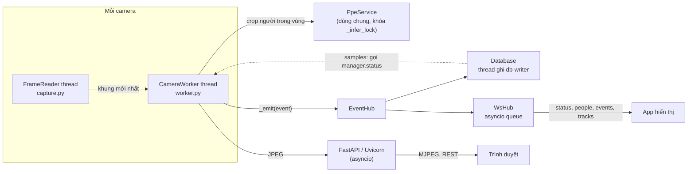

# Tài liệu code

Dành cho người bảo trì / phát triển tiếp. Bản đồ module / luồng dạng graph để đọc nhanh: [GRAPH.md](GRAPH.md). Cài đặt môi trường: [SETUP.md](SETUP.md). Dữ liệu gửi ra ngoài: [WEBSOCKET_API.md](WEBSOCKET_API.md).

## 1. Tổng quan

Một tiến trình Python duy nhất:

- **Backend**: FastAPI + Uvicorn (`app/`). Đọc nhiều camera song song, phát hiện + theo dõi người (Ultralytics YOLO pose + ByteTrack), đếm vào/ra theo line hoặc polygon, kiểm tra PPE (mũ bảo hộ, găng từng tay) cho người trong vùng, lưu SQLite, đẩy WebSocket.
- **Frontend**: HTML + JavaScript thuần (`web/`), không build step. Video xem qua MJPEG, số liệu qua polling `/api/status` mỗi giây.
- **Màn hình 3D** (`Greco2026DashBoard/`, project Vite + TypeScript + three.js riêng, git riêng, bị ignore): đọc `/ws` + `stream.mjpg`, `build_show.bat` build vào `show/` (có trong git, kèm `show/VERSION.txt` ghi commit Greco), server mount ở `/show/`. Đổi Greco thì build lại và commit `show/` để máy triển lãm pull về.
- **Cấu hình**: `config/settings.json` (thông số, camera), sửa qua web.

Nhận diện đồ vật theo từ khóa (YOLOE + CLIP: `world.py`, `clip_verify.py`, `items.py`, `objtrack.py`, `vocabulary.py`, trang `/world`) đã **gỡ tạm**. Code và tài liệu thuật toán của nó còn nguyên ở commit `751e2bd` (`git show 751e2bd:docs/CODE.md`).

Thư viện chính: `ultralytics`, `torch`, `opencv-python`, `fastapi`, `uvicorn`, `websockets`, `lap`.

## 2. Cấu trúc thư mục

```
Exhibition/
├── app/                    Backend (package Python, chạy bằng `python -m app`)
│   ├── __main__.py         Entry point: parse tham số, chdir vào models/, chạy uvicorn
│   ├── main.py             FastAPI: trang, REST API, MJPEG, /ws, API database
│   ├── manager.py          CameraManager: giữ các worker, PpeService, EventHub, Database
│   ├── worker.py           CameraWorker: 1 thread / camera, pipeline xử lý từng khung
│   ├── capture.py          FrameReader: thread đọc RTSP/webcam/file, chỉ giữ khung mới nhất
│   ├── person.py           Person (dataclass), PersonTracker (YOLO pose + ByteTrack)
│   ├── crossing.py         CrossingCounter: line / zone, phía trong-ngoài, lượt vào/ra
│   ├── ppe.py              PpeService (yolo_ppe.pt + mask yolo26n-seg), đọc pixel đầu / tay, PpeEvidence
│   ├── draw.py             Vẽ overlay (người, khung xương, PPE, line, zone, HUD)
│   ├── events.py           EventHub: pub/sub trong tiến trình
│   ├── db.py               Database: SQLite (WAL), thread ghi riêng, truy vấn thống kê, CSV
│   ├── ws.py               WsHub: server WebSocket, topic, tần suất, token
│   ├── settings_store.py   SettingsStore: giá trị mặc định, merge, lưu settings.json (thread-safe)
│   └── paths.py            Đường dẫn chuẩn, resolve_model()
├── web/                    Frontend tĩnh (mount tại /static)
│   ├── index.html, cameras.html, calibrate.html, ppe.html, data.html, socket.html
│   ├── js/common.js        api(), toast(), esc(), renderNav(), định dạng thời gian
│   ├── js/<trang>.js       Logic từng trang
│   └── css/style.css
├── config/                 settings.json (không có trong git); vocabulary.json (của tính năng đồ vật, không dùng)
├── models/                 yolo26n-pose.pt, yolo26n-seg.pt (tools/prepare_models.py), yolo_ppe.pt (copy tay); không có trong git
├── Greco2026DashBoard/     Màn hình 3D (không có trong git của repo này) → build_show.bat → show/
├── data/                   exhibition.sqlite3 (không có trong git)
├── tools/
│   ├── prepare_models.py   Tải model người + mask (setup.bat và Dockerfile gọi)
│   ├── build_portable.ps1  Tạo dist\VisionExpo (Python nhúng + thư viện + app)
│   └── docker_export.ps1   Build image + xuất tar và bộ script cài cho máy khác
├── docker/                 entrypoint.sh, deploy/ (compose + .bat cho máy đích)
├── Dockerfile, docker-compose.yml, .dockerignore
├── setup.bat, start.bat, start_kiosk.bat, build_portable.bat, docker_export.bat
├── requirements.txt
└── docs/
```

## 3. Mô hình luồng (thread)



| Thread / task | Ở đâu | Làm gì |
|---|---|---|
| Uvicorn event loop | `__main__.py` | HTTP, MJPEG (async generator), WebSocket |
| `FrameReader` (1 / camera) | `capture.py` | Đọc liên tục, giữ 1 khung mới nhất + số thứ tự, tự kết nối lại |
| `worker-<id>` (1 / camera) | `worker.py` | Pipeline xử lý, giới hạn bởi `process_fps` |
| `ppe-load`, `ppe-seg-load` | `ppe.py` | Nạp model PPE / mask người ở nền |
| `db-writer` | `db.py` | Gom sự kiện thành batch để ghi, lấy mẫu số liệu định kỳ, xóa dữ liệu cũ |
| Tasks asyncio của `WsHub` | `ws.py` | `_pump_events` (sự kiện → client), `_ticker` cho `status` và `people` |

Nguyên tắc:

- Worker chỉ **đọc khung mới nhất**, không xếp hàng, nên không bị trễ dồn khi xử lý chậm.
- `PpeService` có khóa: nhiều camera dùng chung GPU theo lượt. Mỗi camera chỉ gọi mỗi `ppe.every_n` khung, một batch crop cho các người trong vùng (chi phí tăng theo số người trong vùng).
- Subscriber của `EventHub` được gọi trên thread worker, phải **không chặn** (DB đẩy vào `queue.Queue`, WsHub dùng `loop.call_soon_threadsafe`).
- Dữ liệu chia sẻ giữa các thread (`worker.persons`, `worker.ppe_findings`) được gán nguyên list mới mỗi khung, nên phía đọc luôn thấy một bản đầy đủ.

## 4. Pipeline một khung (`CameraWorker._process`)

1. **Người**: `PersonTracker.track(frame)` → `list[Person]` (box, track_id, keypoints).
2. **Phía / đếm**: `CrossingCounter.update(persons, w, h)` gán `p.side` (`in`/`out`/`unknown`), tính `inside`/`outside`, sinh sự kiện `crossing`.
3. **PPE** (camera có vùng + task `ppe`, mỗi `ppe.every_n` khung): `mode = "crop"` → `PpeService.detect_people()` cắt khung nới rộng (`expand_box`) của từng người trong vùng, batch, gán chủ sẵn; `mode = "frame"` → `detect()` cả khung. `_assign_ppe()` gắn kết quả cho người trong vùng (theo chủ, không theo vị trí box so với polygon). Ở lần chạy PPE: `person_masks()` + `_update_evidence()` ghi bằng chứng từng bộ phận; mỗi khung `_infer_missing()` biến bằng chứng đã xác nhận thành `NO-*` / `Hardhat` / `Gloves` (`inferred`), `_emit_ppe_alerts()` sinh `ppe_alert` (8 giây/lần/người/tổ hợp).
4. **Theo dõi lượt người**: `_update_tracks()` cộng dồn nhãn PPE / phía / có thiếu PPE cho từng `track_id`, phát `track` khi người biến mất quá 3 giây.
5. **Vẽ + phát**: `draw.render()` → resize theo `stream_width` → JPEG → `latest_jpeg()` cho MJPEG.

## 5. Các module chính

### `settings_store.py`

- `GLOBAL_DEFAULTS`, `CAMERA_DEFAULTS`: **nguồn duy nhất** của giá trị mặc định. Khi load, file được deep-merge lên mặc định, nên khóa mới tự có giá trị cho file cũ.
- `update_global(patch)`, `update_camera(id, patch)`: merge, ghi file (atomic qua `.tmp`), trả bản mới.
- `RESTART_FIELDS = {"source", "enabled"}`: đổi các khóa này thì manager tạo worker mới; các khóa khác áp dụng nóng qua `worker.apply_config()`.
- Server giữ cấu hình trong bộ nhớ và **ghi đè file mỗi lần lưu**: sửa tay `settings.json` khi server đang chạy sẽ bị mất.

### `manager.py` – `CameraManager`

Tạo `PpeService`, `EventHub`, `Database` (subscribe `db.on_event`), các `CameraWorker`. CRUD camera, `update_ppe()` (lưu + `ppe.update_config`), `update_section()` cho websocket/database, `status()` gom số liệu mọi camera (dùng cho `/api/status`, WebSocket `status`, và DB lấy mẫu). Thiết bị: `device` trong settings hoặc `--device`; không có CUDA thì tự về `cpu`.

### `capture.py` – `FrameReader`

Phân loại nguồn (`webcam` / `stream` / `file`), mở bằng OpenCV (RTSP qua TCP, timeout 8 giây), thread đọc liên tục, `latest()` trả `(frame, seq)`. Trạng thái: `starting`, `connecting`, `online`, `offline`, `reconnecting`, `stopped`. File video tự phát lặp. `grab_single_frame()` dùng cho nút "Kiểm tra".

### `crossing.py` – `CrossingCounter`

- Xét theo **điểm chân** (`Person.foot_point()`: trung điểm hai mắt cá nếu đủ tin cậy; dự phòng bên dưới).
- **Vùng đệm** `DEAD_ZONE_FRAC` (0.6% đường chéo khung): điểm nằm trong dải này không đổi phía, tránh nhảy qua lại trên biên.
- **line**: dấu của tích chéo với đoạn A–B; phía "trong" là phía chứa `inward_point`. Đổi phía và điểm cắt nằm trong đoạn (cho phép lố 10%) → một lượt.
- **zone**: `cv2.pointPolygonTest` có dấu khoảng cách. Ngoài → trong = `in`, trong → ngoài = `out` kèm `dwell_s`. Track xuất hiện sẵn bên trong: tính là đang ở trong, không phát sinh lượt vào.
- `COOLDOWN_S = 1`: một track không được đếm hai lần trong 1 giây.
- `SIDE_CONFIRM_FRAMES = 3`: phía mới phải giữ 3 khung liên tiếp mới được nhận (khung xương rung khi xoay người làm điểm chân nhảy qua biên).
- Điểm chân dự phòng: mắt cá tin cậy ≥ 0.35 → mắt cá yếu ≥ 0.15 → đầu gối + (đầu gối − hông) → đáy box.
- `inside` / `outside`: đếm `p.side` của khung hiện tại. `entries` / `exits`: cộng dồn, khôi phục từ DB khi khởi động (`restore_counts`).
- Đổi cấu hình hình học (mode/points/zone) thì xóa trạng thái các track.

### `ppe.py` – `PpeService` và suy luận PPE

Sơ đồ, ngưỡng đã đo và lý do: [GRAPH.md §4](GRAPH.md). Tóm tắt:

- `PpeService`: `yolo_ppe.pt` (chỉ giữ 4 lớp `Hardhat, NO-Hardhat, Gloves, NO-Gloves`), `detect_people()` (crop từng người trong vùng, batch) / `detect()` (cả khung), `person_masks()` (`yolo26n-seg.pt` trên cùng các crop). `required` = các loại cần báo thiếu (`ppe.require`, `[]` = không loại nào; `infer_missing` tắt → rỗng).
- Model gần như mù trên camera triển lãm, nên trạng thái lấy từ pixel: `cover_state("hardhat")` → `crown_cover()` (dải trên mắt), `hand_state()` (tỉ lệ da trong vòng tròn sau cổ tay, chỉ trên pixel của người khi có mask).
- `PpeEvidence` (1 / track): 5 lần chạy gần nhất cho `hardhat`, `gloves_L`, `gloves_R`; `None` (không thấy bộ phận) bị bỏ qua nên quay người không mất trạng thái; `last_rel` giữ vị trí cuối để vẽ khi bị che.

### `events.py`, `db.py`, `ws.py`
### `events.py`, `db.py`, `ws.py`

- `EventHub.publish(event)`: mọi sự kiện có `type`, `ts`, `camera_id` (worker tự thêm).
- `Database`: bảng `events` (các trường ngoài cột chuẩn được lưu JSON trong `data`), `tracks`, `samples` (mỗi `sample_every_s` giây). Tên cột giữ từ thời có đồ vật: `tracks.items` / `alert` = nhãn PPE / từng thiếu PPE, `samples.objects` / `alerts` = đếm nhãn PPE / số người thiếu PPE. Đọc dùng kết nối ngắn (WAL cho phép đọc song song). `counts_since_reset()` khôi phục bộ đếm.
- `WsHub`: map `type` → topic (`EVENT_TOPIC`), lọc theo camera của client, gửi có timeout 2 giây (client chậm bị ngắt), hàng đợi sự kiện tối đa 5000. `status` kèm `ppe_required` để client biết loại nào hiện "chưa rõ".

### `draw.py`

Màu theo phía (`SIDE_COLORS`: xanh trong, cam ngoài, xám chưa rõ), đỏ khi thiếu PPE; box PPE xanh (có) / đỏ (`NO-*`). Text qua `ascii_text()` (OpenCV không vẽ được tiếng Việt có dấu).

## 6. REST API

| Method | Đường dẫn | Mô tả |
|---|---|---|
| GET | `/api/status` | Trạng thái mọi camera, tổng, model PPE |
| GET/POST | `/api/cameras` | Danh sách / thêm camera |
| POST | `/api/cameras/test` | Thử nguồn, trả ảnh base64 |
| GET/PUT/DELETE | `/api/cameras/{id}` | Xem / sửa / xóa |
| POST | `/api/cameras/{id}/restart` | Khởi động lại worker |
| PUT | `/api/cameras/{id}/crossing` | `{mode, points, inward_point, zone, tasks}` (tọa độ 0–1; `tasks` ⊂ `count`, `ppe`; `ppe` chỉ với zone) |
| POST | `/api/cameras/{id}/crossing/reset`, `/api/crossing/reset_all` | Reset lượt vào/ra |
| GET | `/api/cameras/{id}/stream.mjpg`, `frame.jpg`, `snapshot.jpg` | Video MJPEG / ảnh có overlay / ảnh gốc |
| GET/PUT | `/api/ppe` | Trạng thái + cấu hình PPE (`enabled`, `mode`, `conf`, `imgsz`, `every_n`, `infer_missing`, `require`, `confirm_runs`, `person_mask`, `mask_imgsz`; PUT kiểm tra và giới hạn từng khóa) |
| GET | `/show/` | Màn hình 3D (static, chỉ có khi `show/` hoặc `Greco2026DashBoard/dist` có `index.html` lúc khởi động) |
| GET/PUT | `/api/ws` | Thông tin client / cấu hình WebSocket |
| WS | `/ws` | WebSocket ([WEBSOCKET_API.md](WEBSOCKET_API.md)) |
| GET/PUT | `/api/db` | Tổng quan + cấu hình database |
| GET | `/api/db/events`, `/api/db/tracks`, `/api/db/hourly`, `/api/db/top_items` | Truy vấn (`from`, `to` Unix giây, `camera_id`, `limit`, `offset`…) |
| GET | `/api/db/export/{events\|tracks}.csv` | CSV (UTF-8 BOM cho Excel) |
| POST | `/api/db/clear` | `{"confirm": "DELETE"}` |

Swagger tự sinh: `http://127.0.0.1:8000/docs`.

## 7. Frontend

- Mỗi trang = một file HTML + một file JS cùng tên, đều nạp `common.js` trước. `renderNav("<key>")` vẽ thanh menu.
- `api(path, {method, body})` gọi REST, ném `Error(detail)` khi lỗi; `toast(msg, isError)` báo nhanh.
- Live và Calibrate poll `/api/status` mỗi giây. Live xem một camera bằng `stream.mjpg`, chế độ lưới dùng `frame.jpg` refresh 250 ms (trình duyệt giới hạn ~6 kết nối MJPEG / host).
- Trang PPE (`/ppe`) tự lưu: `putPpe(patch, delay)` gom thay đổi, debounce ô số 600 ms, gửi nốt bằng `fetch(..., {keepalive: true})` khi rời trang, cảnh báo nếu server bỏ qua khóa không biết. Bật task PPE từng camera gửi lại nguyên `crossing` với `tasks` mới.
- Trang Calibrate vẽ trên `<canvas>` với tọa độ chuẩn hóa 0–1.
- Không có bundler / framework; sửa file và tải lại trang là xong (server trả `Cache-Control: no-cache` cho HTML, `/static` và `/show`).
- Màn hình 3D (`Greco2026DashBoard/src`): `live/types.ts` (schema WS), `live/store.ts` (`LiveStore`, chuẩn hóa người, `stats()`), `live/ppe.ts` (`ppeSummary()`: gộp găng 2 tay, "chưa rõ" theo `ppe_required`), `live/mock.ts` (dữ liệu giả cho nút Test), `ui/chrome.ts` (HUD + khung camera MJPEG góc trái dưới, phóng to bằng cách đổi class trên cùng một `` để không mở thêm kết nối), `scene/people/label.ts` (nhãn trên đầu nhân vật). Kiểm tra: `npx tsc --noEmit`; build: `build_show.bat`.

## 8. Quy trình phát triển

```powershell
# chạy server dev (không mở trình duyệt), cổng riêng để không đụng bản đang chạy
.venv\Scripts\python.exe -m app --port 8011 --no-browser

# kiểm tra cú pháp nhanh
.venv\Scripts\python.exe -m py_compile app\ppe.py app\worker.py
node --check web\js\ppe.js
```

- Hai server cùng chạy sẽ **dùng chung `config/settings.json`** và ghi đè lẫn nhau; khi test bằng cổng khác, nhớ khôi phục giá trị đã đổi.
- `__main__.py` chuyển thư mục làm việc vào `models/` (Ultralytics tải model và bộ mã hóa chữ theo cwd). Đường dẫn trong code luôn dùng `app/paths.py`.
- Test PPE không cần camera: tạo `CameraWorker` với `PpeService` rồi gọi `_process(img)` nhiều lần (không `start()`), xem [GRAPH.md §9](GRAPH.md).
- Ảnh để kiểm tra: `GET /api/cameras/{id}/frame.jpg` (có overlay), `snapshot.jpg` (gốc).

### Thêm một khóa cấu hình PPE

1. Giá trị mặc định trong `GLOBAL_DEFAULTS["ppe"]` (`settings_store.py`).
2. Thêm vào `allowed` và kiểm tra/giới hạn giá trị trong `api_update_ppe` (`main.py`). **Khóa không có trong `allowed` bị bỏ qua.**
3. Đọc bằng `self.cfg.get("key", mặc_định)` trong `ppe.py` / `worker.py` (cfg được cập nhật nóng).
4. Ô nhập trong `web/ppe.html` + `ppe.js` (`bindNumber("id", "key")` cho ô số).
5. Một dòng trong bảng cấu hình của `README.md`.

Khóa camera làm tương tự với `CAMERA_DEFAULTS`, form trong `cameras.html` / `cameras.js`.

### Thêm một loại sự kiện

1. `self._emit({"type": "ten_moi", ...})` trong worker.
2. `EVENT_TOPIC` trong `ws.py` (mặc định đi vào topic `events`).
3. Database tự lưu vào bảng `events` (trường thêm nằm trong cột `data`). Muốn hiển thị trên trang Dữ liệu: `EVENT_TYPES` trong `web/js/data.js`.
4. Cập nhật `docs/WEBSOCKET_API.md` (chép sang `Greco2026DashBoard/WEBSOCKET_API.md`) và tài liệu ở `web/socket.html`. Màn hình 3D cần nhận loại mới: `FeedEvent` trong `live/types.ts`, `ingest()` trong `store.ts`, `feedLine()` trong `ui/chrome.ts`.


## 9. Đóng gói

| Script | Kết quả |
|---|---|
| `build_portable.bat` → `tools/build_portable.ps1` | `dist\VisionExpo\`: Python 3.11 nhúng, torch CUDA, thư viện, `app/ web/ models/ config/ tools/`, `start.bat`, màn hình 3D đã build `show/` + `start_show.bat` (máy build có Node thì gọi `build_show.bat` trước; `-NoShow` để bỏ); và `dist\VisionExpo.zip`. Lần sau chỉ đồng bộ code/model/config và `pip install -r requirements.txt` |
| `docker compose up -d --build` | Image `vision-expo:latest` (Dockerfile tự tải model người + mask nếu `models/` trống) |
| `docker_export.bat` → `tools/docker_export.ps1` | `dist\VisionExpo-docker\`: image `.tar`, compose chỉ chạy, `config/`, `data/`, `install/start/stop/logs.bat` |

Cả hai bản đóng gói đều chứa `config/settings.json` hiện tại (có mật khẩu RTSP).

## 10. Giới hạn đã biết

- `track_id` không liên kết giữa các camera; người bị che lâu có thể nhận mã mới.
- PPE suy ra từ màu điểm ảnh: găng màu da, mũ đen, người tóc sáng / hói, ánh sáng yếu có thể bị đọc sai; ngưỡng đo trên ảnh chụp dashboard (có lớp màu của vùng), nên kiểm lại trên khung gốc.
- Vùng vẽ trên sàn: người đứng sát camera (chân ra ngoài mép dưới khung) có thể bị tính ngoài vùng; vẽ vùng phủ tới mép dưới.
- Docker Desktop trên Windows không dùng được webcam USB.
- OpenCV không vẽ tiếng Việt có dấu lên video (overlay dùng không dấu); giao diện web và dữ liệu thì đầy đủ.
