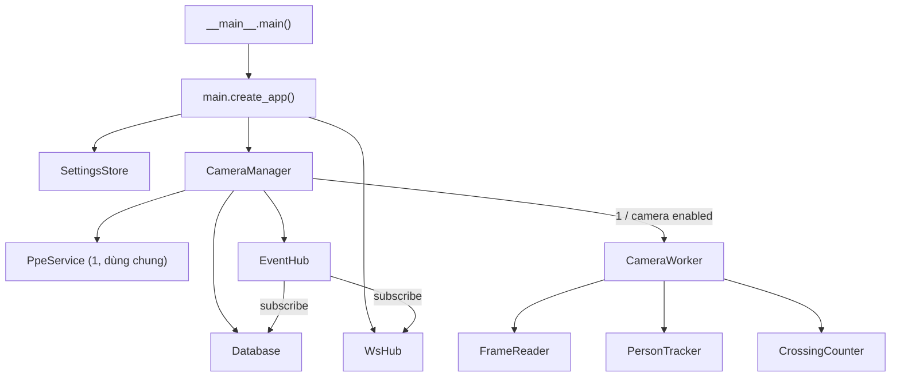
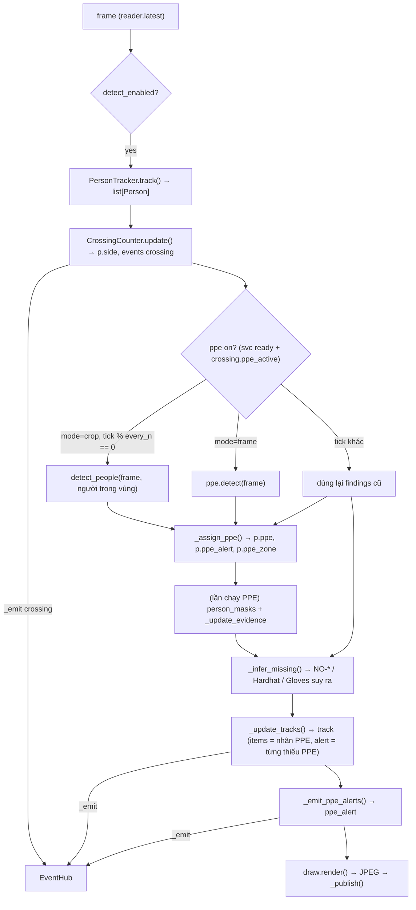
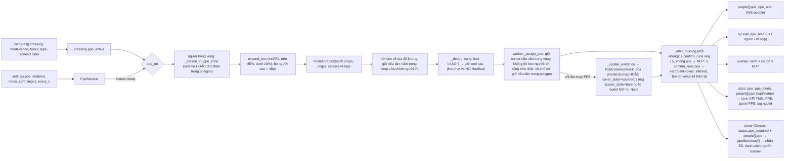

# Bản đồ source dạng graph

Tài liệu đọc nhanh để nắm lại toàn bộ source trước khi sửa. Mỗi phần là một graph: **node** = module / class / hàm / khóa cấu hình / endpoint, **cạnh** = gọi hàm, luồng dữ liệu, đọc cấu hình. Chi tiết thuật toán từng module: [CODE.md](CODE.md). Giao thức WebSocket: [WEBSOCKET_API.md](WEBSOCKET_API.md).

Cách dùng khi có yêu cầu mới: tìm node liên quan ở **§1**, đi theo cạnh ở §2–§7 để biết file nào bị ảnh hưởng, xem **§8** (bất biến / bẫy) trước khi sửa.

Nhận diện đồ vật (YOLOE open-vocabulary + lọc CLIP: `world.py`, `clip_verify.py`, `items.py`, `objtrack.py`, `vocabulary.py`, trang `/world`) đã **gỡ tạm**; bản cuối còn đủ là commit `751e2bd` (`git show 751e2bd:app/world.py`…). `config/vocabulary.json` vẫn để lại trong repo cho lúc khôi phục.

---

## 1. Danh mục node

| Node | File | Loại | Vai trò | Symbol chính |
|---|---|---|---|---|
| `entry` | `app/__main__.py` | entry | Parse CLI, `chdir(models/)`, chạy uvicorn | `main()` |
| `api` | `app/main.py` | FastAPI | Trang HTML, REST, MJPEG, `/ws` | `create_app()` |
| `manager` | `app/manager.py` | singleton | Giữ worker, model dùng chung, EventHub, DB | `CameraManager`, `_usable_device()` |
| `store` | `app/settings_store.py` | singleton | `config/settings.json`, mặc định, merge, thread-safe | `SettingsStore`, `GLOBAL_DEFAULTS`, `CAMERA_DEFAULTS`, `RESTART_FIELDS` |
| `worker` | `app/worker.py` | 1 / camera, thread | Pipeline từng khung, sự kiện, JPEG | `CameraWorker._process()`, `_assign_ppe()`, `_update_tracks()` |
| `reader` | `app/capture.py` | 1 / camera, thread | Đọc RTSP / webcam / file, giữ khung mới nhất | `FrameReader.latest()`, `grab_single_frame()` |
| `person` | `app/person.py` | 1 / camera | YOLO pose + ByteTrack | `PersonTracker.track()`, `Person` (dataclass), `foot_point()` |
| `crossing` | `app/crossing.py` | 1 / camera | Line / zone, `p.side`, lượt vào/ra, task `count`/`ppe` | `CrossingCounter.update()`, `.ppe_active`, `.zone_px()` |
| `ppe` | `app/ppe.py` | dùng chung | Model PPE Hardhat / Gloves / NO-*, mask người, đọc pixel đầu / tay | `PpeService.detect_people()`, `.detect()`, `.person_masks()`, `PpeFinding`, `PpeEvidence`, `cover_state()`, `hand_state()` |
| `draw` | `app/draw.py` | thư viện | Vẽ overlay (người, vùng / line, PPE, HUD) | `render()`, `ascii_text()` |
| `hub` | `app/events.py` | singleton | Pub/sub đồng bộ trong tiến trình | `EventHub.publish()` |
| `db` | `app/db.py` | singleton, thread `db-writer` | SQLite WAL: `events`, `tracks`, `samples` | `Database.on_event()`, `counts_since_reset()` |
| `ws` | `app/ws.py` | singleton, asyncio | Server `/ws`, topic, tần suất, token | `WsHub`, `TOPICS`, `EVENT_TOPIC` |
| `paths` | `app/paths.py` | hằng số | Đường dẫn, tên model mặc định | `resolve_model()`, `PPE_MODEL_DEFAULT`, `MASK_MODEL_DEFAULT`, `SHOW_DIRS` |
| `web/*` | `web/*.html`, `web/js/*.js` | frontend vận hành | JS thuần, không build | `common.js: api(), toast(), renderNav(), fmt*()` |
| `show` | `Greco2026DashBoard/` (repo git riêng, bị ignore) → build vào `show/` | frontend trình chiếu 3D | Vite + TS + three.js; chỉ đọc WebSocket + MJPEG | `live/store.ts: LiveStore`, `live/ppe.ts: ppeSummary()`, `ui/chrome.ts: mount()` |

Model trong `models/`:

| File | Dùng bởi | Ghi chú |
|---|---|---|
| `yolo26n-pose.pt` | `person` | `settings.person_model` |
| `yolo26n-seg.pt` | `ppe` (mask người) | `ppe.mask_model`; thiếu file → tắt mask, PPE vẫn chạy |
| `yolo_ppe.pt` | `ppe` | YOLOv8m, 14 lớp (`Fall-Detected, Gloves, Goggles, Hardhat, Ladder, Mask, NO-Gloves, NO-Goggles, NO-Hardhat, NO-Mask, NO-Safety Vest, Person, Safety Cone, Safety Vest`); app chỉ giữ 4: `Hardhat, NO-Hardhat, Gloves, NO-Gloves`. Copy tay, không tự tải |

---

## 2. Graph sở hữu + thread



| Thread | Sinh bởi | Đọc | Ghi |
|---|---|---|---|
| uvicorn loop | `entry` | `worker.latest_jpeg()`, `manager.status()` | gọi `manager.*` từ REST |
| `FrameReader` / camera | `worker.start()` | camera | `_frame`, `_seq` |
| `worker-<id>` / camera | `worker.start()` | `reader.latest()` | `persons`, `ppe_findings`, `_jpeg` (gán list mới mỗi khung) |
| `ppe-load`, `ppe-seg-load` | `PpeService.ensure_loaded_async()`, `update_config` (bật `person_mask` khi đang chạy) | `yolo_ppe.pt`, `yolo26n-seg.pt` | `ppe.model`, `ppe.seg`, `status` |
| `db-writer` | `db.start()` | `queue.Queue` | SQLite; lấy mẫu qua `manager.status()` |
| asyncio task `_pump_events`, `_ticker` | `ws.start()` | `asyncio.Queue`, `manager.status()` | socket client |

GPU dùng chung theo lượt: `ppe._infer_lock` (model PPE và seg).

---

## 3. Graph pipeline một khung (`CameraWorker._process`)



`Person` là object đi xuyên pipeline; các bước lần lượt điền: `track_id, box, keypoints` (person) → `side` (crossing) → `ppe, ppe_alert, ppe_zone` (worker).

---

## 4. Graph PPE



Vì sao suy ra: `yolo_ppe.pt` mù trên camera triển lãm cả hai chiều (đầu trần rõ: `NO-Hardhat` < 0.03; đeo găng tối: `Gloves` < 0.04), nên "model không thấy dương" không nói lên gì. `ppe.cover_state()` xét pixel: tay = tỉ lệ da trong vòng tròn cổ tay + 0.3 cẳng tay, bán kính 0.25 cẳng tay (`SKIN_BARE` 0.25 / `SKIN_COVERED` 0.08, bỏ pixel đỏ rực như mặt bàn đỏ; box lớn cũ dính ghế da nâu → báo nhầm); đầu = `crown_box` (dải trên mắt, rộng tai–tai) tóc/da vs vỏ sáng/màu (`CROWN_BARE` 0.5 / `CROWN_COVERED` 0.4). Quay lưng: đầu ước từ hai vai (`_head_from_shoulders`), chỉ được kết luận "bare" (tóc tối), không bao giờ "covered". Mask người: `PpeService.person_masks()` chạy `yolo26n-seg.pt` (imgsz 640, batch trên các crop PPE, ~20 ms/người, chỉ ở lần chạy PPE), chọn instance IoU cao nhất với box track; `hand_skin(frame, box, mask)` → (da cả vòng, tỉ lệ vòng thuộc người, da trên pixel người); `hand_state`: phủ ≥ `MASK_MIN_COVER` 0.2 → da-người ≥ 0.4 trần / < 0.1 có găng; phủ thấp → chỉ cho "có găng" khi cả vòng không có da. Găng xét **từng tay** (`hand_box` / `hand_state`, khóa bằng chứng `gloves_L` / `gloves_R`, `worker._update_hands`): mỗi tay tự ra `Gloves` / `NO-Gloves`, một tay đọc sai không quyết định thay tay kia; người có `NO-Gloves` nếu bất kỳ tay nào được xác nhận trần. `PpeEvidence.last_rel` giữ vị trí cuối của tay / đầu (tương đối khung người) để vẽ tiếp khi bộ phận đang bị che. `PpeEvidence.add(None)` bị bỏ qua → trạng thái giữ khi quay người / bị che. `_person_in_ppe_zone`: side `in` hoặc tâm thân trong polygon, giữ thêm `PPE_ZONE_GRACE_S` = 2 s sau lần cuối ở trong. Ngưỡng đo trên ảnh chụp dashboard (có lớp màu xanh của vùng), cần kiểm lại trên khung gốc. `worker._ppe_model` giữ riêng box model (dùng lại giữa các lần chạy), `worker.ppe_findings` = box model + box suy ra. Bằng chứng xóa khi track kết thúc.

Điều kiện PPE chạy (tất cả phải đúng): `ppe.enabled`, model `ready`, camera `crossing.mode == "zone"`, `"ppe" in tasks`, polygon ≥ 3 điểm, `detect_enabled` (cần người). HUD hiện `PPE off (<status>)` khi camera có task ppe nhưng service chưa sẵn sàng.

---

## 5. Graph cấu hình → nơi đọc

| Khóa | Đọc ở | Áp dụng |
|---|---|---|
| `device` | `manager._usable_device` | khởi động (CLI `--device` ghi đè) |
| `person_model` | `manager` → `PersonTracker` | khởi động |
| `ppe.enabled, mode, conf, imgsz, every_n, infer_missing, require, confirm_runs, person_mask, mask_imgsz` | `PpeService.cfg` (`.mode`, `.required`, `.confirm_runs`), `worker._process` | nóng qua `PUT /api/ppe` (trang `/ppe`). `require: []` = không báo thiếu loại nào |
| `ppe.model`, `ppe.mask_model` | `PpeService._load` / `_load_seg` | khởi động (seg cũng nạp khi bật `person_mask` lúc đang chạy) |
| `cameras[].source, enabled` | `RESTART_FIELDS` → tạo worker mới | `PUT /api/cameras/{id}` |
| `cameras[].conf, imgsz, process_fps, stream_width, jpeg_quality, show_*, detect_enabled` | `worker.cfg` | nóng (`apply_config`) |
| `cameras[].crossing` | `CrossingCounter.set_config` (đổi hình học → xóa trạng thái track) | nóng qua `PUT /api/cameras/{id}/crossing` |
| `websocket.*` | `WsHub.cfg` | nóng qua `PUT /api/ws` |
| `database.*` | `Database._cfg()` (getter) | nóng qua `PUT /api/db` |

Mặc định chỉ ở `settings_store.GLOBAL_DEFAULTS` / `CAMERA_DEFAULTS`; file cũ được deep-merge lên mặc định khi load. Khóa `world` / `cameras[].world_enabled` trong `settings.json` cũ được giữ nguyên nhưng không còn ai đọc.

---

## 6. Graph sự kiện

| `type` | Sinh ở | Trường thêm | Topic WS | DB |
|---|---|---|---|---|
| `crossing` | `crossing.update` → `worker._process` | `track_id, direction, mode, dwell_s?` | `events` | `events` (dùng cho `counts_since_reset`) |
| `ppe_alert` | `worker._emit_ppe_alerts` (8s / người / tổ hợp) | `items` (NO-*), `all_items` | `events` (mặc định) | `events` |
| `track` | `worker._finish_track` (mất dấu > 3s, ≥ 5 khung) | `first_ts, last_ts, duration, items` (nhãn PPE → số khung), `alert` (từng có NO-*), `first_side, last_side` | `tracks` | bảng `tracks` |
| `camera` | `worker._check_state` | `status, error` | `events` | `events` |
| `reset` | `worker.reset_counts` | — | `events` | `events` (mốc khôi phục đếm) |

Luồng: `worker._emit` → `EventHub.publish` (đồng bộ, trên thread worker) → `db.on_event` (đẩy `queue.Queue`) và `ws._on_event` (`call_soon_threadsafe`). Trang Dữ liệu hiển thị tên loại qua `EVENT_TYPES` trong `web/js/data.js`. Cột DB giữ tên cũ: `tracks.items/alert`, `samples.objects/alerts` nay chứa nhãn PPE / số người thiếu PPE (dòng cũ thời có đồ vật giữ nghĩa cũ; `alert` cũ vẫn đọc được ở `/data`).

---

## 7. Graph endpoint ↔ trang web

| Trang | JS | Gọi |
|---|---|---|
| `/` Live | `live.js` | `/api/status` (1s), `stream.mjpg` / `frame.jpg`, `/api/crossing/reset_all` |
| `/cameras` | `cameras.js` | `/api/cameras` CRUD, `/api/cameras/test`, `/restart`, `/api/status` |
| `/calibrate` | `calibrate.js` | `/api/cameras/{id}`, `snapshot.jpg`, `PUT /crossing` (mode, points, zone, tasks), `/crossing/reset` |
| `/ppe` | `ppe.js` | `GET/PUT /api/ppe` (tự lưu, debounce), `/api/cameras`, `PUT /api/cameras/{id}/crossing` (bật/tắt task `ppe`) |
| `/data` | `data.js` | `/api/db*`, export CSV, `/api/db/clear` |
| `/socket` | `socket.js` | `/api/ws`, `WebSocket /ws` |
| `/show/` (Greco) | `Greco2026DashBoard/src` | `WebSocket /ws?topics=status,people,events`, `/api/db/events` (lấy bù), `stream.mjpg` của camera đang chọn (khung góc trái dưới, bấm để phóng to; cùng một kết nối MJPEG) |

| Endpoint | Handler → đích |
|---|---|
| `GET /api/status` | `manager.status()` (camera stats + totals + `ppe.info()`) |
| `PUT /api/cameras/{id}` | `manager.update_camera` → restart hoặc `apply_config` |
| `PUT /api/cameras/{id}/crossing` | validate → `manager.update_camera({"crossing"})` |
| `GET/PUT /api/ppe` | `ppe.info()` / `manager.update_ppe` |
| `/ws` | `WsHub.handle` (topics `status, people, events, tracks`; lọc `cameras`; `token`) |
| `/show` | `StaticFiles(show/ hoặc Greco2026DashBoard/dist)`, chỉ mount nếu có `index.html` lúc khởi động |

PPE hiển thị trên Live (KPI "Thiếu PPE", panel "PPE trong vùng" khi camera đang xem có task ppe, tag "Thiếu mũ / găng" ở danh sách người). Cấu hình PPE ở trang `/ppe`; task `ppe` của từng camera bật ở `/ppe` hoặc `/calibrate`.

---

## 8. Bất biến và bẫy

- **Khung mới nhất, không xếp hàng**: worker bỏ khung cũ; chậm thì giảm FPS chứ không trễ dồn.
- **Gán list mới** cho `worker.persons/ppe_findings` mỗi khung; thread khác chỉ đọc. Đừng sửa list tại chỗ.
- **Subscriber EventHub không được chặn** (chạy trên thread worker).
- **Tọa độ cấu hình chuẩn hóa 0–1**; worker đổi sang pixel mỗi khung (`zone_px`, `line_px`).
- **Vùng/đếm theo điểm chân**, không theo box. Polygon thường vẽ trên sàn → đầu người nằm ngoài polygon; mọi thứ gắn theo người phải xét "người có trong vùng", không xét vị trí box vật.
- **Model chạy cả khung bị letterbox về `imgsz`**: 1920×1080 → 640 thu nhỏ 3 lần; vật nhỏ (mũ, găng) ở xa mất. PPE dùng crop vì vậy.
- **Server ghi đè `settings.json`** mỗi lần lưu: sửa tay khi đang chạy sẽ mất. Hai server cùng chạy dùng chung file.
- **`cwd = models/`** khi chạy (`__main__`); luôn dùng `paths.py` cho đường dẫn.
- **`track_id` từ ByteTrack của person**; bằng chứng PPE (`_ppe_evidence`) gắn theo mã này và bị xóa khi track kết thúc.
- **Greco không phải một phần của repo này**: `Greco2026DashBoard/` có git riêng; đổi payload WS thì sửa `src/live/types.ts` + `store.ts`, chạy `build_show.bat` để chép bản build vào `show/`, rồi **commit `show/`** (máy triển lãm lấy màn hình 3D qua `git pull`, không có Node). `show/VERSION.txt` (cũng ở `/show/VERSION.txt`) ghi commit Greco của bản build.
- `settings.json` chứa mật khẩu RTSP, không có trong git, nhưng nằm trong bản đóng gói.

## 9. Kiểm thử nhanh không cần camera

```python
# cwd = Exhibition, python của .venv
from app.worker import CameraWorker; from app.ppe import PpeService
ppe = PpeService({"mode": "crop", "every_n": 1})  # chờ ppe.status == "ready"
cam = {"id": "t", "source": "x.mp4", "conf": 0.3, "imgsz": 640,
       "crossing": {"mode": "zone", "zone": [{"x":0,"y":0.5},{"x":1,"y":0.5},{"x":1,"y":1},{"x":0,"y":1}], "tasks": ["ppe"]}}
w = CameraWorker(cam, person_weights="models/yolo26n-pose.pt", device="0", ppe=ppe)
for _ in range(3): w._process(img)          # img = cv2.imread(...)
w.people_detail(); w.ppe_findings; w.latest_jpeg()
```

Không gọi `w.start()` nên không mở nguồn video, không đụng `settings.json`.
