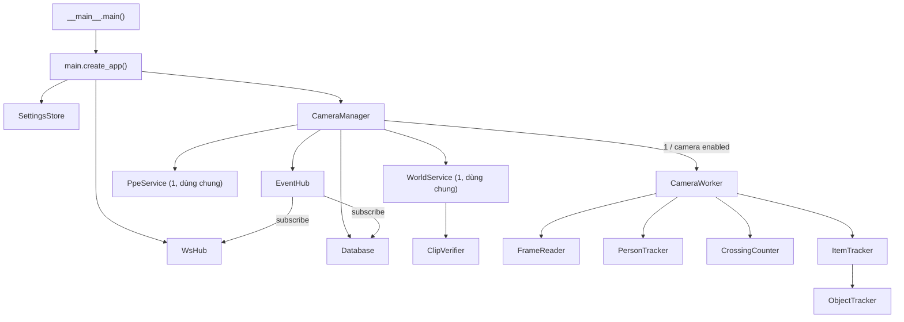
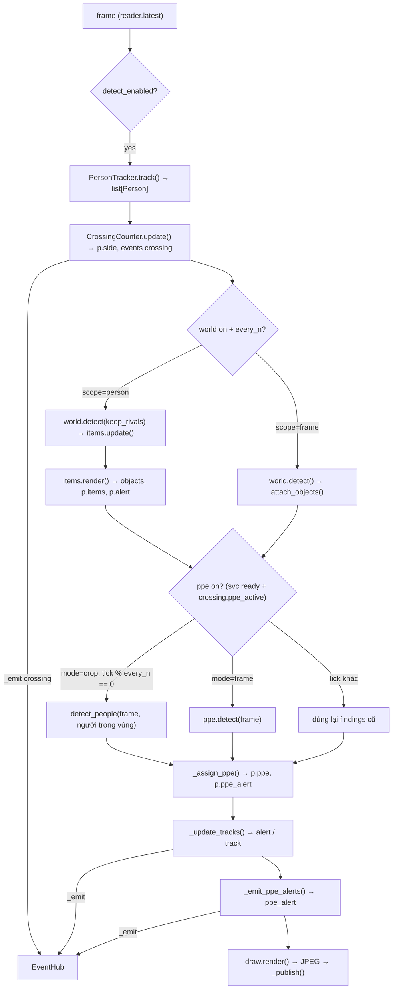
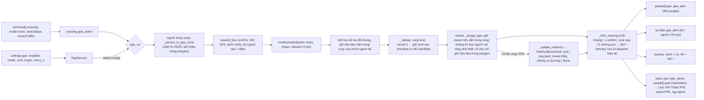

# Bản đồ source dạng graph

Tài liệu đọc nhanh để nắm lại toàn bộ source trước khi sửa. Mỗi phần là một graph: **node** = module / class / hàm / khóa cấu hình / endpoint, **cạnh** = gọi hàm, luồng dữ liệu, đọc cấu hình. Chi tiết thuật toán từng module: [CODE.md](CODE.md). Giao thức WebSocket: [WEBSOCKET_API.md](WEBSOCKET_API.md).

Cách dùng khi có yêu cầu mới: tìm node liên quan ở **§1**, đi theo cạnh ở §2–§7 để biết file nào bị ảnh hưởng, xem **§8** (bất biến / bẫy) trước khi sửa.

---

## 1. Danh mục node

| Node | File | Loại | Vai trò | Symbol chính |
|---|---|---|---|---|
| `entry` | `app/__main__.py` | entry | Parse CLI, `chdir(models/)`, chạy uvicorn | `main()` |
| `api` | `app/main.py` | FastAPI | Trang HTML, REST, MJPEG, `/ws` | `create_app()` |
| `manager` | `app/manager.py` | singleton | Giữ worker, model dùng chung, EventHub, DB | `CameraManager`, `_usable_device()` |
| `store` | `app/settings_store.py` | singleton | `config/settings.json`, mặc định, merge, thread-safe | `SettingsStore`, `GLOBAL_DEFAULTS`, `CAMERA_DEFAULTS`, `RESTART_FIELDS` |
| `worker` | `app/worker.py` | 1 / camera, thread | Pipeline từng khung, sự kiện, JPEG | `CameraWorker._process()`, `_assign_ppe()`, `_update_tracks()` |
| `reader` | `app/capture.py` | 1 / camera, thread | Đọc RTSP / webcam / file, giữ khung mới nhất | `FrameReader.latest()`, `grab_single_frame()` |
| `person` | `app/person.py` | 1 / camera | YOLO pose + ByteTrack | `PersonTracker.track()`, `Person` (dataclass), `foot_point()` |
| `crossing` | `app/crossing.py` | 1 / camera | Line / zone, `p.side`, lượt vào/ra, task `count`/`ppe` | `CrossingCounter.update()`, `.ppe_active`, `.zone_px()` |
| `world` | `app/world.py` | dùng chung | Model đồ vật open-vocab (YOLOE), ngưỡng theo nhãn, dedup | `WorldService.detect()`, `WorldObject`, `bake_vocabulary()` |
| `clip` | `app/clip_verify.py` | dùng chung (trong `world`) | Lọc box bằng CLIP (tùy chọn `world.clip_verify`) | `ClipVerifier.filter()` |
| `items` | `app/items.py` | 1 / camera (trong `worker`) | Track vật, gán người, bỏ phiếu nhãn (scope person) | `ItemTracker.update()`, `.render()`, `Slot` |
| `objtrack` | `app/objtrack.py` | 1 / camera (trong `items`) | ByteTrack cho đồ vật, bộ đếm mã riêng | `ObjectTracker.update()` |
| `ppe` | `app/ppe.py` | dùng chung | Model PPE Hardhat / Gloves / NO-* | `PpeService.detect_people()`, `.detect()`, `PpeFinding`, `expand_box()` |
| `vocab` | `app/vocabulary.py` | thư viện | Từ vựng mặc định, đọc/ghi `vocabulary.json` | `DEFAULT_VOCABULARY`, `flatten_classes()`, `alert_labels()` |
| `draw` | `app/draw.py` | thư viện | Vẽ overlay, gán vật (scope frame) | `render()`, `attach_objects()` |
| `hub` | `app/events.py` | singleton | Pub/sub đồng bộ trong tiến trình | `EventHub.publish()` |
| `db` | `app/db.py` | singleton, thread `db-writer` | SQLite WAL: `events`, `tracks`, `samples` | `Database.on_event()`, `counts_since_reset()` |
| `ws` | `app/ws.py` | singleton, asyncio | Server `/ws`, topic, tần suất, token | `WsHub`, `TOPICS`, `EVENT_TOPIC` |
| `paths` | `app/paths.py` | hằng số | Đường dẫn, tên model mặc định | `resolve_model()`, `PPE_MODEL_DEFAULT` |
| `web/*` | `web/*.html`, `web/js/*.js` | frontend | JS thuần, không build | `common.js: api(), toast(), renderNav()` |

Model trong `models/`:

| File | Dùng bởi | Ghi chú |
|---|---|---|
| `yolo26n-pose.pt` | `person` | `settings.person_model` |
| `yoloe_exhibition.pt` (+ `.json` chữ ký) | `world` | Bake từ `yoloe-26l-seg.pt` + `vocabulary.json`; khác chữ ký → tự bake lại |
| `mobileclip2_b.ts` | `bake_vocabulary` | Chỉ cần khi bake |
| `yolo_ppe.pt` | `ppe` | YOLOv8m, 14 lớp (`Fall-Detected, Gloves, Goggles, Hardhat, Ladder, Mask, NO-Gloves, NO-Goggles, NO-Hardhat, NO-Mask, NO-Safety Vest, Person, Safety Cone, Safety Vest`); app chỉ giữ 4: `Hardhat, NO-Hardhat, Gloves, NO-Gloves`. Copy tay, không tự tải |

---

## 2. Graph sở hữu + thread



| Thread | Sinh bởi | Đọc | Ghi |
|---|---|---|---|
| uvicorn loop | `entry` | `worker.latest_jpeg()`, `manager.status()` | gọi `manager.*` từ REST |
| `FrameReader` / camera | `worker.start()` | camera | `_frame`, `_seq` |
| `worker-<id>` / camera | `worker.start()` | `reader.latest()` | `persons`, `objects`, `ppe_findings`, `_jpeg` (gán list mới mỗi khung) |
| `world-load`, `world-rebuild` | `WorldService` | model | `world.model`, `status` |
| `ppe-load` | `PpeService.ensure_loaded_async()` | `yolo_ppe.pt` | `ppe.model`, `status` |
| `db-writer` | `db.start()` | `queue.Queue` | SQLite; lấy mẫu qua `manager.status()` |
| asyncio task `_pump_events`, `_ticker` | `ws.start()` | `asyncio.Queue`, `manager.status()` | socket client |

GPU dùng chung theo lượt: `world._infer_lock`, `ppe._infer_lock`.

---

## 3. Graph pipeline một khung (`CameraWorker._process`)



`Person` là object đi xuyên pipeline; các bước lần lượt điền: `track_id, box, keypoints` (person) → `side` (crossing) → `items, alert` (world/items) → `ppe, ppe_alert` (worker).

---

## 4. Graph PPE



Vì sao suy ra âm: lớp `NO-Hardhat` của `yolo_ppe.pt` cho < 0.03 với người đầu trần nhìn rõ trên camera triển lãm; lớp dương mới đáng tin. `worker._ppe_model` giữ riêng box model (dùng lại giữa các lần chạy), `worker.ppe_findings` = box model + box suy ra. Bằng chứng xóa khi track kết thúc.

Điều kiện PPE chạy (tất cả phải đúng): `ppe.enabled`, model `ready`, camera `crossing.mode == "zone"`, `"ppe" in tasks`, polygon ≥ 3 điểm, `detect_enabled` (cần người). HUD hiện `PPE off (<status>)` khi camera có task ppe nhưng service chưa sẵn sàng.

---

## 5. Graph cấu hình → nơi đọc

| Khóa | Đọc ở | Áp dụng |
|---|---|---|
| `device` | `manager._usable_device` | khởi động (CLI `--device` ghi đè) |
| `person_model` | `manager` → `PersonTracker` | khởi động |
| `world.*` | `WorldService.cfg`, `ItemTracker.update(cfg)`, `worker._process` | nóng qua `PUT /api/world` |
| `ppe.enabled, mode, conf, imgsz, every_n, infer_missing, require, confirm_runs` | `PpeService.cfg` (`.mode`, `.required`, `.confirm_runs`), `worker._process` | nóng qua `PUT /api/ppe` |
| `ppe.model` | `PpeService._load` | khởi động |
| `cameras[].source, enabled` | `RESTART_FIELDS` → tạo worker mới | `PUT /api/cameras/{id}` |
| `cameras[].conf, imgsz, process_fps, stream_width, jpeg_quality, show_*, world_enabled, detect_enabled` | `worker.cfg` | nóng (`apply_config`) |
| `cameras[].crossing` | `CrossingCounter.set_config` (đổi hình học → xóa trạng thái track) | nóng qua `PUT /api/cameras/{id}/crossing` |
| `websocket.*` | `WsHub.cfg` | nóng qua `PUT /api/ws` |
| `database.*` | `Database._cfg()` (getter) | nóng qua `PUT /api/db` |

Mặc định chỉ ở `settings_store.GLOBAL_DEFAULTS` / `CAMERA_DEFAULTS`; file cũ được deep-merge lên mặc định khi load.

---

## 6. Graph sự kiện

| `type` | Sinh ở | Trường thêm | Topic WS | DB |
|---|---|---|---|---|
| `crossing` | `crossing.update` → `worker._process` | `track_id, direction, mode, dwell_s?` | `events` | `events` (dùng cho `counts_since_reset`) |
| `alert` | `worker._update_tracks` (vũ khí, 30s / người) | `items, all_items` | `events` | `events` |
| `ppe_alert` | `worker._emit_ppe_alerts` (8s / người / tổ hợp) | `items` (NO-*), `all_items` | `events` (mặc định) | `events` |
| `track` | `worker._finish_track` (mất dấu > 3s, ≥ 5 khung) | `first_ts, last_ts, duration, items, alert, first_side, last_side` | `tracks` | bảng `tracks` |
| `camera` | `worker._check_state` | `status, error` | `events` | `events` |
| `reset` | `worker.reset_counts` | — | `events` | `events` (mốc khôi phục đếm) |

Luồng: `worker._emit` → `EventHub.publish` (đồng bộ, trên thread worker) → `db.on_event` (đẩy `queue.Queue`) và `ws._on_event` (`call_soon_threadsafe`). Trang Dữ liệu hiển thị tên loại qua `EVENT_TYPES` trong `web/js/data.js`.

---

## 7. Graph endpoint ↔ trang web

| Trang | JS | Gọi |
|---|---|---|
| `/` Live | `live.js` | `/api/status` (1s), `/api/world`, `stream.mjpg` / `frame.jpg`, `/api/crossing/reset_all` |
| `/cameras` | `cameras.js` | `/api/cameras` CRUD, `/api/cameras/test`, `/restart`, `/api/status` |
| `/calibrate` | `calibrate.js` | `/api/cameras/{id}`, `snapshot.jpg`, `PUT /crossing` (mode, points, zone, tasks), `/crossing/reset` |
| `/world` | `world.js` | `GET/PUT /api/world`, `PUT /api/world/vocabulary`, `PUT /api/cameras/{id}` (`world_enabled`) |
| `/data` | `data.js` | `/api/db*`, export CSV, `/api/db/clear` |
| `/socket` | `socket.js` | `/api/ws`, `WebSocket /ws` |

| Endpoint | Handler → đích |
|---|---|
| `GET /api/status` | `manager.status()` (camera stats + totals + `world.info()` + `ppe.info()`) |
| `PUT /api/cameras/{id}` | `manager.update_camera` → restart hoặc `apply_config` |
| `PUT /api/cameras/{id}/crossing` | validate → `manager.update_camera({"crossing"})` |
| `GET/PUT /api/world` | `world.info()` / `manager.update_world` |
| `GET/PUT /api/ppe` | `ppe.info()` / `manager.update_ppe` |
| `/ws` | `WsHub.handle` (topics `status, people, events, tracks`; lọc `cameras`; `token`) |

PPE hiển thị trên Live (KPI "Thiếu PPE", panel "PPE trong vùng" khi camera đang xem có task ppe, tag "Thiếu mũ / găng" ở danh sách người). Chưa có giao diện chỉnh cấu hình PPE (chỉ checkbox task `ppe` ở `/calibrate`); chỉnh qua `PUT /api/ppe`.

---

## 8. Bất biến và bẫy

- **Khung mới nhất, không xếp hàng**: worker bỏ khung cũ; chậm thì giảm FPS chứ không trễ dồn.
- **Gán list mới** cho `worker.persons/objects/ppe_findings` mỗi khung; thread khác chỉ đọc. Đừng sửa list tại chỗ.
- **Subscriber EventHub không được chặn** (chạy trên thread worker).
- **Tọa độ cấu hình chuẩn hóa 0–1**; worker đổi sang pixel mỗi khung (`zone_px`, `line_px`).
- **Vùng/đếm theo điểm chân**, không theo box. Polygon thường vẽ trên sàn → đầu người nằm ngoài polygon; mọi thứ gắn theo người phải xét "người có trong vùng", không xét vị trí box vật.
- **Model chạy cả khung bị letterbox về `imgsz`**: 1920×1080 → 640 thu nhỏ 3 lần; vật nhỏ (mũ, găng, kính) ở xa mất. PPE dùng crop vì vậy; `world` vẫn chạy cả khung.
- **Server ghi đè `settings.json`** mỗi lần lưu: sửa tay khi đang chạy sẽ mất. Hai server cùng chạy dùng chung file.
- **`cwd = models/`** khi chạy (`__main__`); luôn dùng `paths.py` cho đường dẫn.
- **`track_id` từ ByteTrack của person**; `objtrack` có bộ đếm riêng để không reset mã người.
- `settings.json` chứa mật khẩu RTSP, không có trong git, nhưng nằm trong bản đóng gói.

## 9. Kiểm thử nhanh không cần camera

```python
# cwd = Exhibition, python của .venv
from app.worker import CameraWorker; from app.world import WorldService; from app.ppe import PpeService
world = WorldService({"enabled": False}); ppe = PpeService({"mode": "crop", "every_n": 1})  # chờ ppe.status == "ready"
cam = {"id": "t", "source": "x.mp4", "conf": 0.3, "imgsz": 640,
       "crossing": {"mode": "zone", "zone": [{"x":0,"y":0.5},{"x":1,"y":0.5},{"x":1,"y":1},{"x":0,"y":1}], "tasks": ["ppe"]}}
w = CameraWorker(cam, person_weights="models/yolo26n-pose.pt", device="0", world=world, ppe=ppe)
for _ in range(3): w._process(img)          # img = cv2.imread(...)
w.people_detail(); w.ppe_findings; w.latest_jpeg()
```

Không gọi `w.start()` nên không mở nguồn video, không đụng `settings.json`.
